

<a href="https://okaybabe.com"><picture><source media="(prefers-color-scheme: dark)" srcset="https://raw.githubusercontent.com/Okay-Babe/.github/main/profile/assets/v1/banner-dark.png">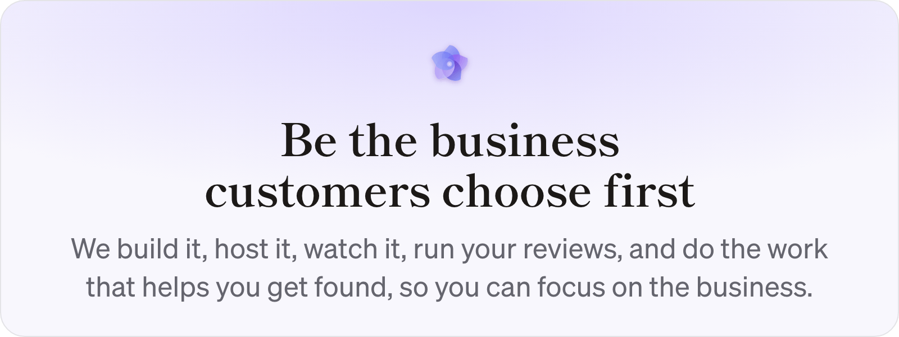</picture></a>

<a href="https://okaybabe.com/audit"><picture><source media="(prefers-color-scheme: dark)" srcset="https://raw.githubusercontent.com/Okay-Babe/.github/main/profile/assets/v1/btn-audit-dark.png"></picture></a>
<a href="https://cal.com/okaybabe/introduction?overlayCalendar=true"><picture><source media="(prefers-color-scheme: dark)" srcset="https://raw.githubusercontent.com/Okay-Babe/.github/main/profile/assets/v1/btn-demo-dark.png"></picture></a>
<a href="https://okaybabe.com/contact"><picture><source media="(prefers-color-scheme: dark)" srcset="https://raw.githubusercontent.com/Okay-Babe/.github/main/profile/assets/v1/btn-contact-dark.png"></picture></a>

### Build, host, reputation, and rank

<a href="https://okaybabe.com/services/website-design"><picture><source media="(prefers-color-scheme: dark)" srcset="https://raw.githubusercontent.com/Okay-Babe/.github/main/profile/assets/v1/svc-website-design-dark.png">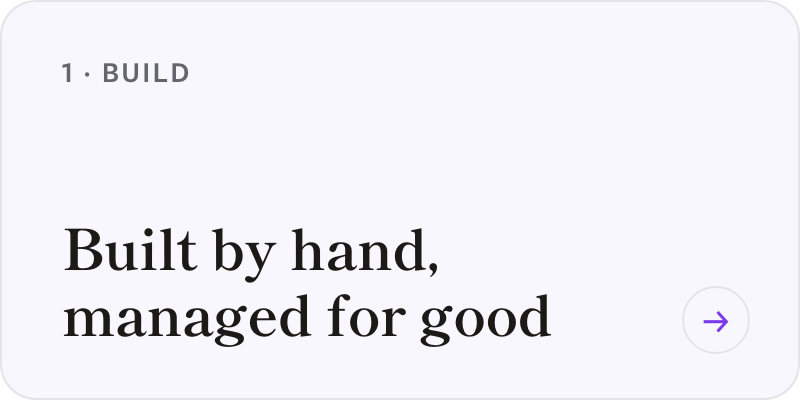</picture></a>
<a href="https://okaybabe.com/services/managed-hosting"><picture><source media="(prefers-color-scheme: dark)" srcset="https://raw.githubusercontent.com/Okay-Babe/.github/main/profile/assets/v1/svc-managed-hosting-dark.png">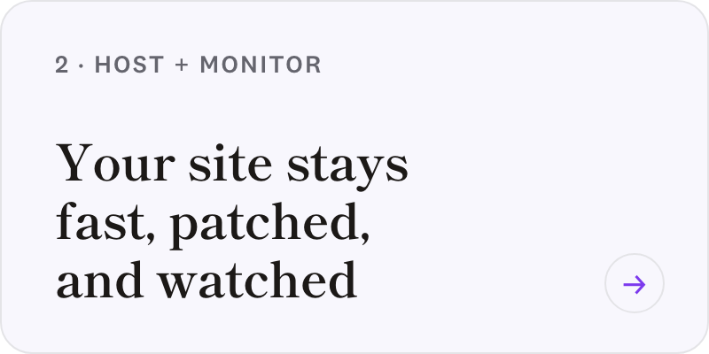</picture></a>
<a href="https://okaybabe.com/services/reputation"><picture><source media="(prefers-color-scheme: dark)" srcset="https://raw.githubusercontent.com/Okay-Babe/.github/main/profile/assets/v1/svc-reputation-dark.png">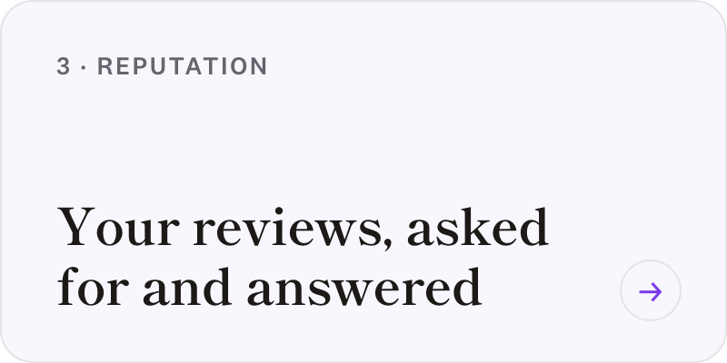</picture></a>
<a href="https://okaybabe.com/services/seo"><picture><source media="(prefers-color-scheme: dark)" srcset="https://raw.githubusercontent.com/Okay-Babe/.github/main/profile/assets/v1/svc-seo-dark.png">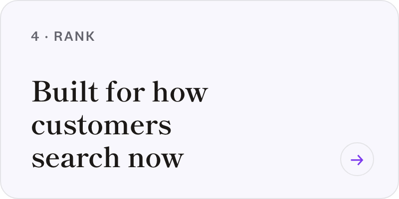</picture></a>

### Created around how customers search.

<a href="https://okaybabe.com/work/chalk-ridge-roof-co"><picture><source media="(prefers-color-scheme: dark)" srcset="https://raw.githubusercontent.com/Okay-Babe/.github/main/profile/assets/v1/work-chalk-ridge-dark.png">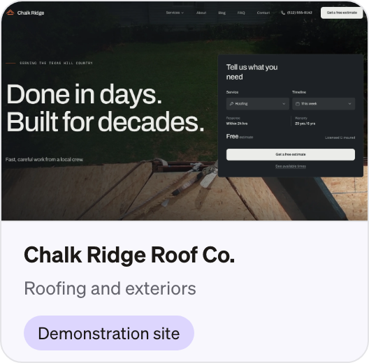</picture></a>
<a href="https://okaybabe.com/work/harborline-moving"><picture><source media="(prefers-color-scheme: dark)" srcset="https://raw.githubusercontent.com/Okay-Babe/.github/main/profile/assets/v1/work-harborline-dark.png">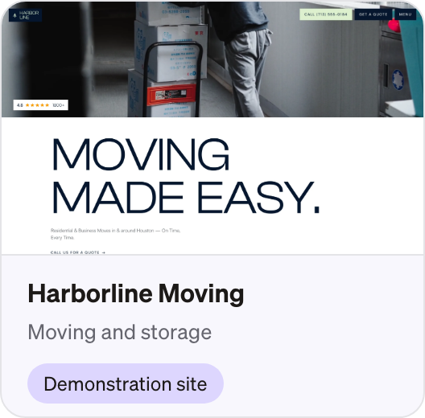</picture></a>
<a href="https://okaybabe.com/work/wexler-heating-air"><picture><source media="(prefers-color-scheme: dark)" srcset="https://raw.githubusercontent.com/Okay-Babe/.github/main/profile/assets/v1/work-wexler-dark.png">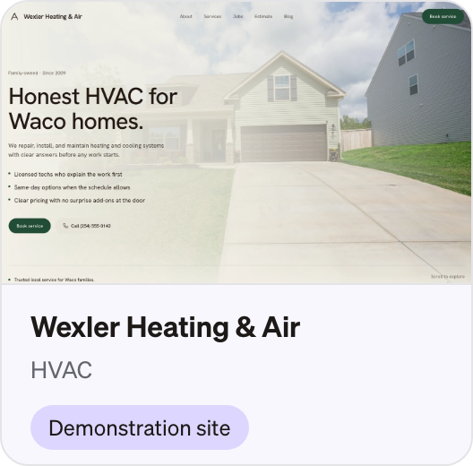</picture></a>

### Free tools. Straight answers.

<a href="https://okaybabe.com/audit"><picture><source media="(prefers-color-scheme: dark)" srcset="https://raw.githubusercontent.com/Okay-Babe/.github/main/profile/assets/v1/tool-audit-dark.png">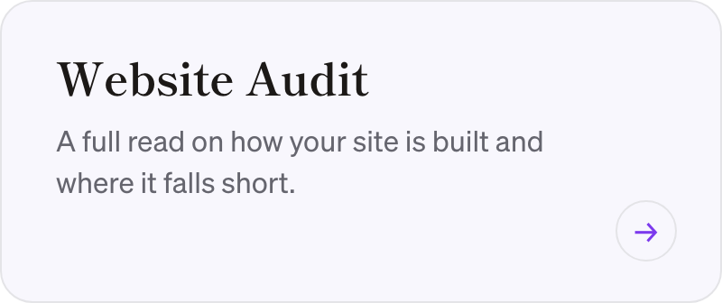</picture></a>
<a href="https://okaybabe.com/tools/security-scan"><picture><source media="(prefers-color-scheme: dark)" srcset="https://raw.githubusercontent.com/Okay-Babe/.github/main/profile/assets/v1/tool-security-scan-dark.png">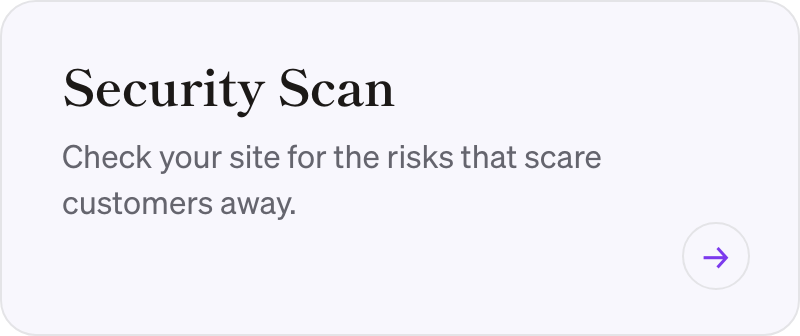</picture></a>
<a href="https://okaybabe.com/tools/roofing-calculator"><picture><source media="(prefers-color-scheme: dark)" srcset="https://raw.githubusercontent.com/Okay-Babe/.github/main/profile/assets/v1/tool-roofing-dark.png">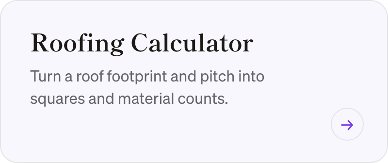</picture></a>
<a href="https://okaybabe.com/tools/takeoff"><picture><source media="(prefers-color-scheme: dark)" srcset="https://raw.githubusercontent.com/Okay-Babe/.github/main/profile/assets/v1/tool-takeoff-dark.png">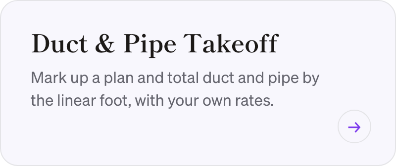</picture></a>

### Open source. Free to use.

<a href="https://github.com/Okay-Babe/okaybabe-shaders"><picture><source media="(prefers-color-scheme: dark)" srcset="https://raw.githubusercontent.com/Okay-Babe/.github/main/profile/assets/v1/oss-shaders-dark.png">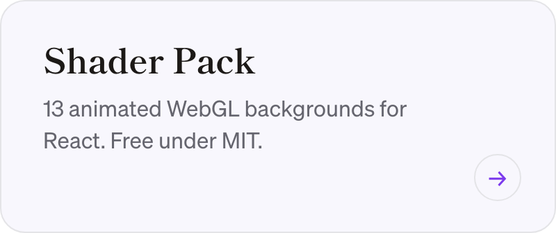</picture></a>
<a href="https://github.com/Okay-Babe/okaybabe-gradient-pack"><picture><source media="(prefers-color-scheme: dark)" srcset="https://raw.githubusercontent.com/Okay-Babe/.github/main/profile/assets/v1/oss-gradient-dark.png">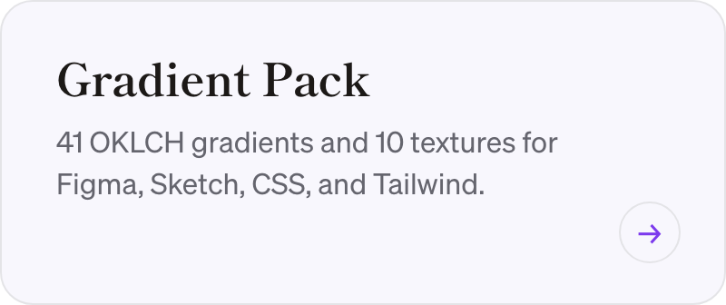</picture></a>

### From first audit to every month after.

<a href="https://okaybabe.com/audit"><picture><source media="(prefers-color-scheme: dark)" srcset="https://raw.githubusercontent.com/Okay-Babe/.github/main/profile/assets/v1/steps-dark.png">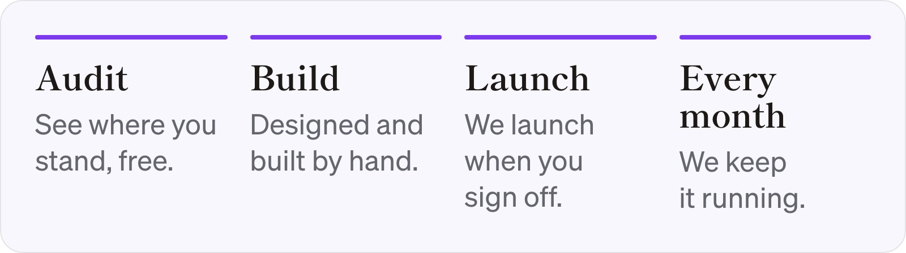</picture></a>

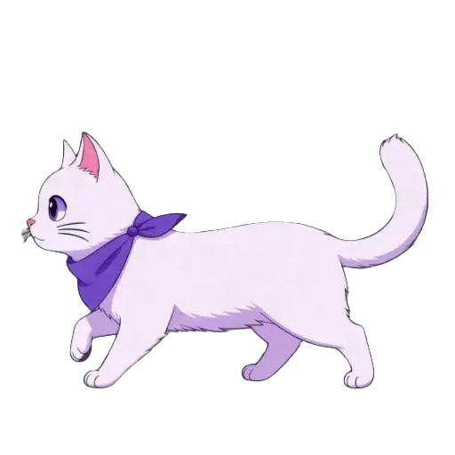 this is lulu.

<a href="https://okaybabe.com">okaybabe.com</a> · Austin, TX · (512) 612-9400 · hello@okaybabe.com · @heyokaybabe

